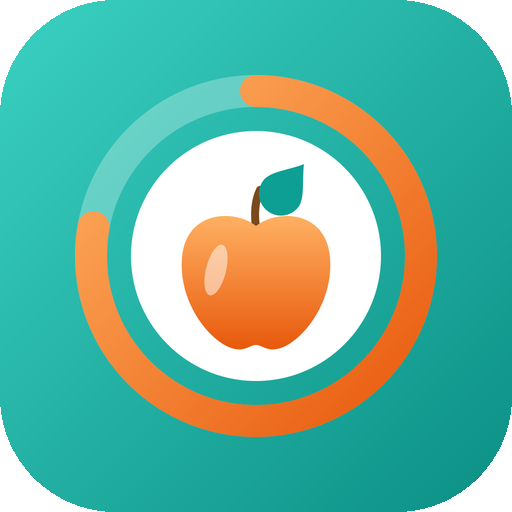
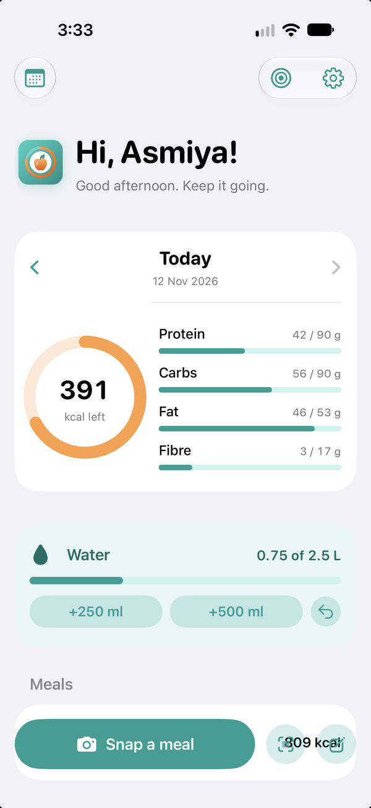
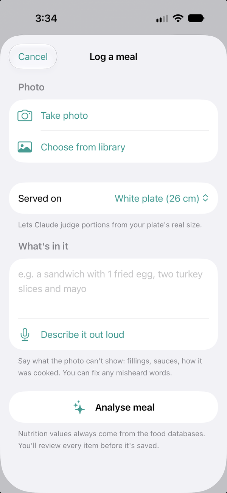
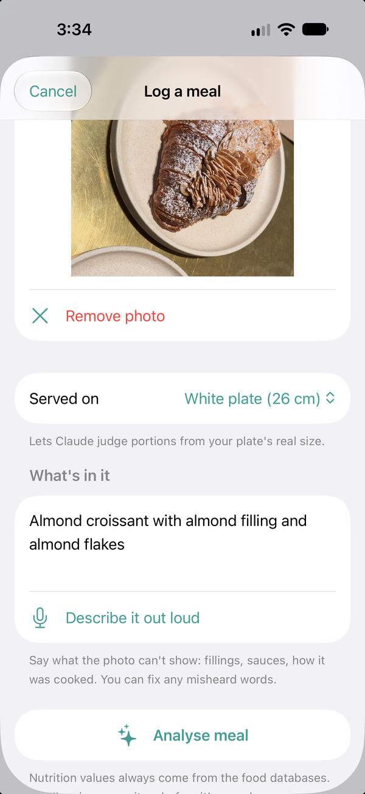
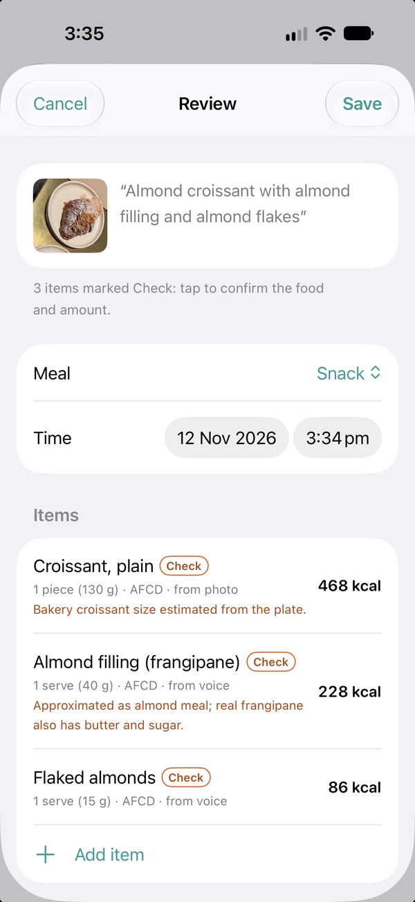

<p align="center">
  
</p>

<h1 align="center">FoodLogger</h1>

<p align="center">
  A personal calorie, nutrient and water tracker for iPhone.<br>
  Snap a meal, say what's in it, check it, done.
</p>

---

FoodLogger is a native SwiftUI app I built for myself because the calorie trackers on the App Store didn't fit how I eat. I cook a lot of different cuisines at home, including South Asian dishes that aren't in any database. I don't want to type in every ingredient, and I want to trust the numbers.

So FoodLogger uses AI for what it's good at (recognising food and estimating portions) and real nutrition databases for everything else. **The AI never makes up a nutrition number.**

<p align="center">
  
  &nbsp;
  
  &nbsp;
  
  &nbsp;
  
</p>
<p align="center"><sub>Today · Log a meal · Photo and description · Review with database-backed items</sub></p>

## Features

**Logging**
- 📸 **Photo + voice logging.** Take a photo, say "beef tehari with a side of raita", and Claude identifies each item and estimates portions.
- 🍛 **Mixed dishes.** Be it biryani, ramen, pad thai or chilli con carne, mixed dishes are broken down into their ingredients using a typical home-style recipe. Each ingredient is looked up in a real database, and the whole dish can be resized in one go. Once logged, it's saved as *your* recipe.
- ✅ **Review before saving.** Every item shows where its numbers came from. Guesses are marked **Check**, and questions like "How much oil?" appear on the item.
- 🥄 **Household measures.** Adjust in cups, ladles, pieces or slices instead of guessing grams.
- 🔎 **Search** your foods, the Australian Food Composition Database, Open Food Facts and USDA, ranked so plain common foods come first ("banana" before "banana chips").
- 🏷️ **Barcode scanning** for packaged food.

**It learns**
- ⭐ Remembers the foods, brands and recipes you log, your usual amounts, and the words you use for them.
- 📏 Learns how your real portions compare with photo estimates and adjusts future estimates to match.
- 🍽️ Uses your actual plate and bowl sizes as a scale reference in photos.

**Daily tracking**
- 🎯 Calorie goal with protein, carbs and fat calculated from it (Balanced, Higher protein, Lower carb or custom split).
- 💧 Water tracking with one-tap buttons and smart reminders that only nudge you when you're behind pace. Log water straight from the notification.
- 📅 History calendar with a weekly chart and averages.
- ⚖️ Weight tracking with a smoothed trend line, weekly rate and an optional goal weight.
- 🗣️ Siri and Shortcuts: "Log 500 ml of water in FoodLogger", "How many calories do I have left?"
- 📱 Home and lock screen widgets: water so far, a +250 ml button and calories left
- 💾 Backup and restore to iCloud Drive or anywhere in Files.
- 🌗 Light and dark mode, kcal or kJ.

## How the AI stays honest

Claude (Anthropic's model) never returns calories or macros. It only does two things:

1. **Identifies foods** by searching the app's food databases through a tool, and picks results **by ID**.
2. **Estimates amounts** in grams.

The app then calculates nutrition from the database values. If Claude references a food ID it didn't get from a search, the item is treated as "no match" and you pick the food yourself. Every logged item records its source (AFCD, Open Food Facts, USDA or your own foods).

More detail: [docs/AI_PIPELINE.md](docs/AI_PIPELINE.md)

## Built with

- Swift, SwiftUI and SwiftData (iOS 27, multiplatform project)
- Claude Sonnet 5.5 via the Claude API, with tool use
- Apple frameworks: Speech (on-device transcription), VisionKit (barcode scanning), Swift Charts, App Intents (Siri), WidgetKit, UserNotifications, ImageIO
- No backend and no third-party Swift packages

## Getting started

### Requirements
- A Mac with Xcode 27
- An iPhone on iOS 27 (iPad and Mac targets are set up but not yet tuned)
- A [Claude API key](https://console.anthropic.com) (each meal analysis costs roughly a cent or two)
- Optional: a free [USDA FoodData Central API key](https://fdc.nal.usda.gov/api-key-signup)

### Setup
1. Clone the repo and open `FoodLogger.xcodeproj`.
2. Copy `Secrets.example.plist` to `FoodLogger/Secrets.plist` and add your keys. This file is in `.gitignore` and never committed. (Keys can also be entered in the app's Settings, where they're stored in the Keychain.)
3. In **Signing & Capabilities**, choose your own team and change the bundle identifier.
4. Select your iPhone and press **Run**.

With a free Apple developer account, the app needs re-installing from Xcode every 7 days. The app reminds you the day before and your data is kept. See [docs/DEVELOPMENT.md](docs/DEVELOPMENT.md) for details, tests and tools.

## Project structure

```
FoodLogger/
├── Today/          Home screen: greeting, calorie ring, macros, water, meals
├── Capture/        Photo + voice capture, speech recognition, image prep
├── MealParser/     Claude meal analysis and portion learning
├── FoodSearch/     Databases, search ranking, the food search screen
├── Logging/        Review and edit screens
├── Barcode/        Camera scanning and lookup
├── Goals/          Goals screen (energy, macros, fibre, water, reminders)
├── History/        Calendar, weekly chart
├── Weight/         Weight card, logging, trend chart
├── Intents/        Siri and Shortcuts
├── Backup/         Backup and restore
├── Plates/         Plate and bowl sizes
├── Onboarding/     Welcome, tutorial
├── Settings/       Settings, remembered foods
├── Shared/         Theme, keychain, helpers
└── Resources/      Bundled Australian food database (afcd.json)
FoodLoggerCore/     Code shared by the app and the widget
├── Models/         SwiftData models
├── Shared/         Settings keys, goals, the shared database (App Group)
├── Reminders/      Water reminders and notification actions
└── Widget/         Widget refresh, settings mirror, the +250 ml intent
FoodLoggerWidget/   Home and lock screen widgets
Tools/              Scripts to rebuild the food database and app icon
Design/             Wireframes and icon sources
docs/               Architecture, AI pipeline, development guide
```

Full walkthrough: [docs/ARCHITECTURE.md](docs/ARCHITECTURE.md)

## Data sources and credits

- **[Australian Food Composition Database](https://www.foodstandards.gov.au/science-data/food-nutrient-databases/afcd), Release 3**, © Food Standards Australia New Zealand, licensed under [CC BY 4.0](https://creativecommons.org/licenses/by/4.0/). A converted copy (8 core nutrients per food) is bundled in `FoodLogger/Resources/afcd.json`.
- **[Open Food Facts](https://world.openfoodfacts.org)**, © Open Food Facts contributors, [Open Database License](https://opendatacommons.org/licenses/odbl/1-0/). Queried live, not bundled.
- **[USDA FoodData Central](https://fdc.nal.usda.gov)**, U.S. Department of Agriculture, public domain. Queried live, not bundled.

## Privacy

- Your food log, water, saved foods and settings live on your device only.
- Speech is transcribed on-device where the phone supports it.
- When you analyse a meal, the photo (shrunk to about 1024 px) and your description are sent to the Claude API. Food searches go to Open Food Facts and USDA. Nothing else leaves the phone.
- API keys stay in `Secrets.plist` (git-ignored) or the device Keychain.

## Roadmap

- [ ] iCloud sync, then iPad and Mac layouts (needs a paid developer account)
- [ ] Home screen and lock screen widgets
- [ ] Apple Health write-back
- [ ] Weekly insights from Claude
- [ ] Depth-based (LiDAR) portion measurement

## Licence

The code is released under the [MIT Licence](LICENSE). The bundled Australian food data is © Food Standards Australia New Zealand under [CC BY 4.0](https://creativecommons.org/licenses/by/4.0/).

## Disclaimer

This is a personal project, not medical or dietary advice. Nutrition values are only as accurate as the source databases and the portion estimates.
