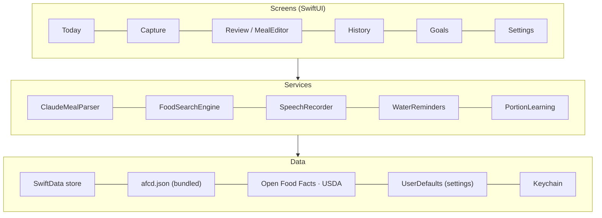
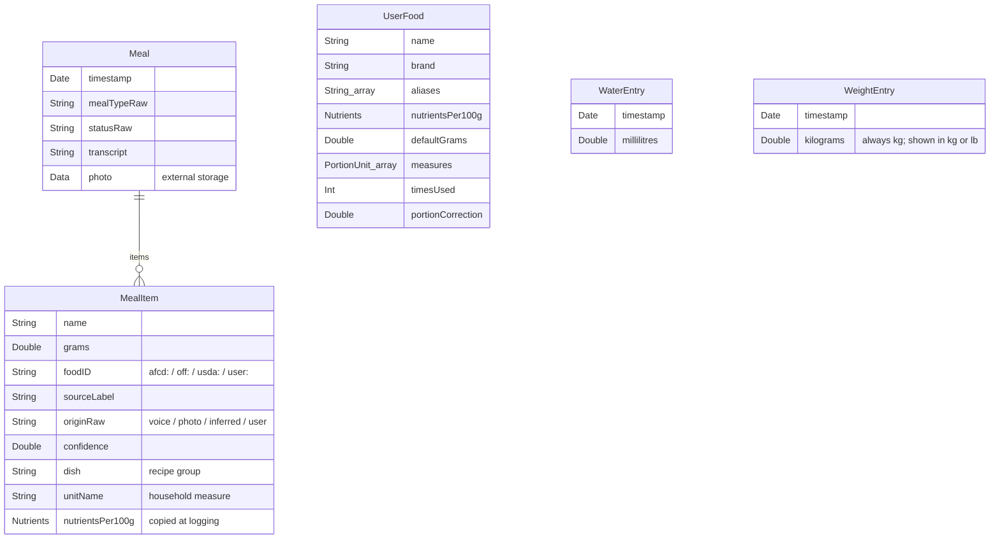
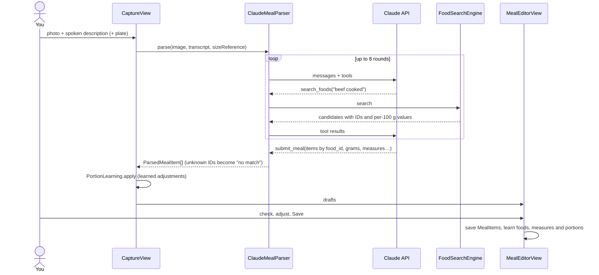

# Architecture

FoodLogger is a single SwiftUI app target with no backend. Everything runs on the device. The only network calls go to the Claude API (meal analysis), Open Food Facts and USDA (food lookups).

## Layers

- **Screens** hold UI state only. They read data with `@Query` and settings with `@AppStorage`.
- **Services** are plain types (`struct`/`enum`) with no UI. Network and search code is `nonisolated` so it can run off the main thread.
- **Data** is SwiftData for your log, `UserDefaults` for settings, and the Keychain for API keys.

## Folder map

There are three source folders. `FoodLogger/` is the app only. `FoodLoggerCore/` is compiled into both the app and the widget extension. `FoodLoggerWidget/` is the widget only.

| Folder | What's in it |
| --- | --- |
| `FoodLoggerCore/Models/` | SwiftData models (`Meal`, `MealItem`, `UserFood`, `WaterEntry`, `WeightEntry`), the `Nutrients` value type, and enums |
| `FoodLoggerCore/Shared/` | `SettingsKey`, `GoalDefaults`, `MacroGoals`, formatting, and `SharedStore` (the database, `AppGroup`, the one-time store move, `DailySnapshot`) |
| `FoodLoggerCore/FoodSearch/` | `FoodCandidate`, `PortionUnit` and `SearchRanking` (needed by the models) |
| `FoodLoggerCore/Reminders/` | Water reminder scheduling and the notification action handler |
| `FoodLoggerCore/Widget/` | `WidgetSync` (redraws the widget), `SettingsMirror`, `AddWaterIntent` (the widget's +250 ml button) |
| `FoodLogger/Today/` | `TodayView` (greeting, day picker, sheets) and `DayView` (one day's queries and lists); ring, bars and rows in `TodayComponents` |
| `FoodLogger/Capture/` | `CaptureView` (photo, plate, voice, Analyse), `SpeechRecorder`, `CameraPicker`, `ImagePrep` |
| `FoodLogger/MealParser/` | `ClaudeMealParser` (the AI loop) and `PortionLearning` |
| `FoodLogger/FoodSearch/` | The three sources, `FoodSearchEngine`, `FoodSearchView` |
| `FoodLogger/Logging/` | `MealEditorView` (review/edit a meal), `ItemEditorView` (one item, with `AmountEditor`), `DraftItem` |
| `FoodLogger/Barcode/` | VisionKit scanner, lookup and quick-log flow |
| `Goals/`, `History/`, `Settings/`, `Onboarding/`, `Plates/`, `Backup/` | One feature each (in `FoodLogger/`) |
| `FoodLogger/Weight/` | `WeightTrend` (smoothing and weekly rate), `WeightCard` on Today, `WeightEntrySheet`, `WeightHistoryView` (chart and list) |
| `FoodLogger/Intents/` | Siri and Shortcuts (App Intents) |
| `FoodLogger/Shared/` | `Theme`, `KeychainStore`, `APIKeys`, `AppExpiry`, platform helpers |
| `FoodLoggerWidget/` | The "Today" widget: small, medium, lock-screen rectangular and circular |

## Data model

Key decisions:

- **Nutrients are copied into each `MealItem` when it's logged.** History never changes if a database updates.
- **`MealItem.nutrients` is calculated** from `nutrientsPer100g × grams / 100`. The app does this maths, never the AI.
- **Food IDs carry their source**, for example `afcd:F003718`, `off:9300633…`, `usda:171287` or `user:<uuid>`.
- **`UserFood` is the learning store**: remembered foods, brands, recipes, other names (aliases), household measures, usual amounts and portion corrections.
- **Ready for iCloud.** Every property has a default or is optional, relationships are optional, there are no unique constraints, and photos use external storage. Turning on CloudKit sync later needs no migration.
- **Goals and preferences live in `UserDefaults`** (`SettingsKey`), not SwiftData. They're small and global.

## Main flows

### Photo + voice logging

Details in [AI_PIPELINE.md](AI_PIPELINE.md).

### Saving and learning (`MealEditorView.save`)

1. Writes `Meal` and `MealItem`s (with photo if **Keep meal photos** is on).
2. `updateMyFoods`, for each remembered item:
   - finds or creates its `UserFood` (matched by food ID, source ID or name),
   - updates usage count, last used, usual amount, brand and measures,
   - adds other names (aliases) so the user's words match next time,
   - records a portion correction if the amount was estimated from the photo.
3. Each recipe dish (items sharing a `dish` name) is saved as one `UserFood` with combined nutrition, labelled "My recipe".

### Food search and ranking

- `FoodSearchEngine` (used by the AI) searches saved foods, then AFCD, then goes online only when needed: Open Food Facts for branded-looking queries or few results, USDA as a fallback. If nothing matches every word, it retries word by word.
- `FoodSearchView` (manual search) shows all sources side by side.
- `SearchRanking.score` puts plain common foods first. Whole-word matches only, the first part of a database name ("Banana" in "Banana, raw") weighs most, category-first names ("Nut, almond") are recognised, processed forms and parts ("chip", "oil", "yolk") are pushed down, and raw is preferred unless you typed a preparation.
- `SavedFoodRanking` also matches aliases and brands, and boosts frequently used foods.

### Water reminders

`WaterReminders.reschedule` runs when water is logged, settings change, or the app comes to the foreground. It schedules a week of local notifications, skipping any slot where you'd already be on pace and stopping once today's goal is reached. Notification buttons (+250/+500 ml) are handled by `NotificationHandler`, which writes to the shared store.

### Siri and Shortcuts

`Intents/FoodLoggerIntents.swift` defines `LogWaterIntent`, `CaloriesLeftIntent`, `WaterProgressIntent` and `SnapMealIntent`, plus `FoodLoggerShortcuts` (the Siri phrases). Intents use `SharedStore.container`, the same database as the app. "Snap a meal" sets `pendingLaunchAction`, which `TodayView` picks up to open the camera.

### Widget

The database lives in the App Group (`group.com.asmiyahasan.FoodLogger`) so the widget can read it. On first launch after the widget was added, `StoreMigration` copies the old `default.store` from the app's own folder into the group and renames the old files to `*.premigration` as a safety copy.

The app's settings stay in `UserDefaults.standard` (`@AppStorage`). `SettingsMirror` copies them into the App Group's `UserDefaults` whenever they change, and `DailySnapshot`, `WaterReminders` and the widget read from there.

`WidgetSync.startObserving()` (called in `FoodLoggerApp.init`) redraws the widget after any SwiftData save or settings change. The widget's +250 ml button runs `AddWaterIntent` inside the widget extension: it saves a `WaterEntry`, removes water reminders that are no longer needed and records `widgetChangedAt`. When the app next becomes active, `ContentView` sees that timestamp and rebuilds `TodayView` so its queries pick up the new water.

### Weight

`WeightEntry` stores each weigh-in in kilograms. `WeightTrend.points` keeps the latest weigh-in per day and runs an exponentially smoothed average over them (10% per day, adjusted for missed days, as in *The Hacker's Diet*). `weeklyRate` is the least-squares slope of the trend over the last 4 weeks. The Today card, the History chart and the "to goal" figure all use the trend rather than the raw reading. The goal weight lives in `SettingsKey.goalWeightKg` (0 means no goal).

`WeightReminders` schedules weigh-in reminders every 1, 2, 3 or 7 days at a chosen time (set in Goals → Weight). The count restarts from the latest weigh-in, so a reminder is skipped if you've already weighed in; weekly reminders are skipped if you weighed in during the 6 days before. It schedules the next 8 and is rescheduled when the app opens, when a weigh-in is saved or deleted, and when the settings change. Tapping the notification sets `pendingLaunchAction` to `logWeight`, which opens the log weight sheet.

### Backup

`BackupService` writes one JSON file (`BackupFile`, version 1) with settings, meals (photos optional), water and saved foods. New fields are optional so older backups still restore. Restore replaces everything after a confirmation.

## Concurrency

The project uses Swift's approachable concurrency settings, with **main-actor default isolation**:

- UI code and SwiftData models are main-actor.
- Types used off the main thread or inside `Codable`/`Sendable` contexts are marked `nonisolated` (for example `Nutrients`, `FoodCandidate`, the API clients and response types).
- Audio capture (`RecognitionSession`) is `nonisolated` and hops back to the main actor with a weak reference.

## Platforms

The project targets iOS, iPadOS, macOS and visionOS. iPhone-only pieces are wrapped in `#if os(iOS)` (camera picker, barcode scanner), and `PlatformHelpers` papers over small API differences (keyboard types, inline titles, images from data). Only iPhone has been tested so far.
